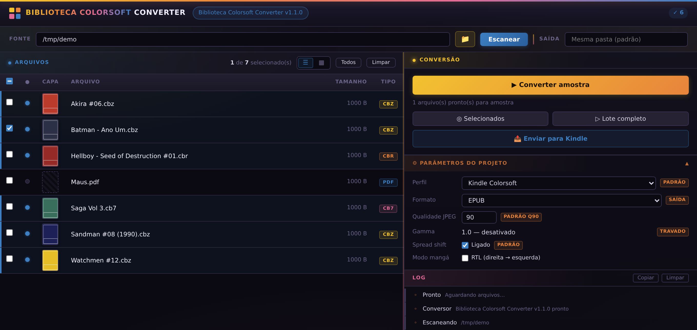
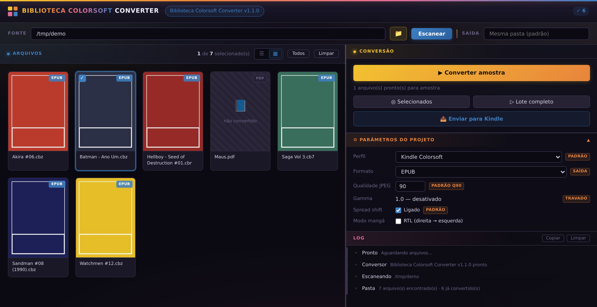

# Biblioteca Colorsoft Converter

Converte quadrinhos em **CBR, CBZ, CB7 e PDF** para **EPUB otimizado para o Kindle Colorsoft** — sem enviar nada para a nuvem e sem depender de ferramentas externas de conversão.

O motor é próprio, escrito em Python puro: redimensiona para a resolução exata da tela (1264×1680), detecta e divide páginas duplas, declara a capa corretamente para o Kindle gerar a miniatura na biblioteca, e grava um EPUB 3 *pre-paginated*. A interface roda no navegador, em `localhost`, com conversão em lote e acompanhamento em tempo real.



## Por que existe

A maioria dos conversores exige subir os arquivos para algum serviço, ou depende de executáveis externos que quebram a cada atualização. Este roda inteiramente na sua máquina: você aponta uma pasta, ele lê os arquivos onde estão e grava o EPUB ao lado do original. Nada sai do computador.

## Instalação

```bash
pip install -r requirements.txt
python app.py
```

O navegador abre sozinho em `http://localhost:5432`.

### Para converter CBR

O formato RAR precisa de um extrator externo. Basta ter **um** dos dois:

- **7-Zip** instalado — [7-zip.org](https://7-zip.org) *(recomendado, detectado automaticamente)*
- **`unrar.exe`** na pasta do programa — [rarlab.com](https://www.rarlab.com/rar_add.htm)

O conversor procura o 7-Zip primeiro e cai para o unrar se não encontrar.

### Para converter CB7

```bash
pip install py7zr
```

## Como usar

1. Clique em 📁 e escolha a pasta com os quadrinhos (ou cole o caminho)
2. **Converter amostra** processa um arquivo só, para você conferir o resultado antes do lote
3. **Selecionados** ou **Lote completo** convertem o resto
4. Use o link **Enviar para Kindle** para abrir o Send to Kindle e mandar os EPUBs

O programa lembra a última pasta e os ajustes, então nas próximas vezes ele já abre pronto.

## Recursos

- **Capa correta** — declarada como `cover-image` no OPF, então o Kindle gera a miniatura na biblioteca
- **Páginas duplas** — detectadas e divididas em duas, com modo mangá (direita → esquerda)
- **Miniaturas** — a capa de cada arquivo já convertido aparece na lista e em modo galeria
- **Conversão em lote** com progresso em tempo real e cancelamento
- **Memória de preferências** — última pasta, pasta de saída, perfil e parâmetros
- **Seletor de pasta nativo** do sistema
- **Escrita atômica** — uma falha no meio da conversão nunca corrompe um EPUB que já existia
- **Tolerante a scans imperfeitos** — aproveita JPEGs truncados e ignora resíduos de empacotamento (`__MACOSX`, `Thumbs.db`)

## Perfis de dispositivo

| Perfil | Resolução |
|---|---|
| Kindle Colorsoft *(padrão)* | 1264 × 1680 |
| Kindle 11ª geração | 1072 × 1448 |
| Kindle Paperwhite 5 | 1236 × 1648 |
| Kindle Voyage / Oasis | 1072 × 1448 |
| Kobo HD / Glo HD | 1080 × 1429 |
| Kobo Mini / Touch | 600 × 800 |

## Modo galeria



## Estrutura do projeto

| Arquivo | Função |
|---|---|
| `app.py` | Servidor Flask — escaneia pastas, gerencia a fila, serve a interface |
| `converter.py` | Motor de conversão — extrai, processa e monta o EPUB |
| `templates/index.html` | Interface completa (HTML, CSS e JS em arquivo único) |
| `requirements.txt` | Dependências Python |
| `settings.json` | Preferências salvas *(criado automaticamente)* |

## Notas técnicas

O EPUB gerado é **EPUB 3 pre-paginated**: cada página é uma imagem em tela cheia, com `rendition:layout` fixo e `page-progression-direction` respeitando o modo mangá. As imagens vão para o ZIP sem recompressão (JPEG já é comprimido), e o OPF é escrito por último, o que permite processar página a página sem carregar o livro inteiro na memória — um álbum de 80 páginas em alta resolução usa cerca de 60 MB.

O servidor aceita apenas conexões de `localhost` e recusa requisições vindas de outras origens.

## Licença

MIT — veja [LICENSE](LICENSE).
